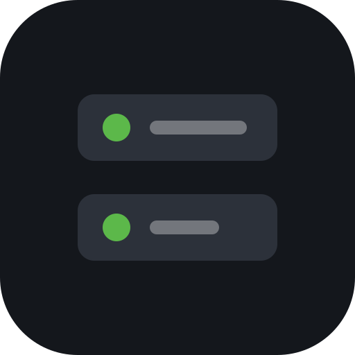
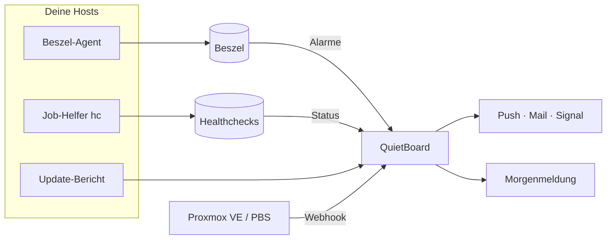

<p align="center">
  
</p>

<h1 align="center">QuietBoard</h1>

<p align="center">
  <strong>Dein Homelab auf einen Blick – still, solange alles läuft.</strong><br>
  Hosts, Backups und Updates in einer ruhigen Ansicht. Eine Morgenmeldung statt hundert Alarme. Richtet sich selbst ein.
</p>

<p align="center">
  <a href="https://github.com/A13nka/quietboard/actions/workflows/ci.yml"></a>
  <a href="https://github.com/A13nka/quietboard/releases/latest"></a>
  <a href="LICENSE"></a>
  
  
</p>

<p align="center">
  <a href="#schnellstart">Schnellstart</a> ·
  <a href="https://a13nka.github.io/quietboard/">Dokumentation</a> ·
  <a href="https://github.com/A13nka/quietboard/releases">Releases</a> ·
  <a href="README.md">English</a>
</p>

<p align="center">
  
  
  &nbsp;
  
  
  &nbsp;
  
  
</p>

---

## Warum QuietBoard?

[Beszel](https://github.com/henrygd/beszel) überwacht deine Rechner, [Healthchecks](https://github.com/healthchecks/healthchecks) deine Cronjobs und Backups. Beide sind hervorragend – aber sie einzurichten, die Alarme zu verdrahten und zwei Dashboards im Blick zu behalten, ist Arbeit. Und meistens willst du nur eins wissen: **Ist alles in Ordnung?**

QuietBoard installiert beide, richtet sie für dich ein und legt eine ruhige Ansicht darüber – im Browser und als App auf dem Handy. Ist alles grün, bleibt es still. Geht etwas kaputt, erfährst du es sofort. Jeden Morgen kommt eine kurze Zusammenfassung.

## Funktionen

- **Eine Übersicht** – Hosts (CPU, RAM, Disk), Jobs (Backups, Skripte, Proxmox-Aufgaben) und ausstehende Updates, sortiert nach dem, was Aufmerksamkeit braucht.
- **Still bei Erfolg, laut bei Fehlern** – Push, Mail oder Signal, wenn ein Host ausfällt, ein Backup fehlt oder Security-Updates liegen bleiben. Sonst eine **Morgenmeldung**.
- **Richtet sich selbst ein** – ein Befehl installiert den Stack; Healthchecks und Beszel werden samt Alarmen automatisch eingerichtet.
- **Ein Befehl pro Host** – Beszel-Agent (Docker oder Binary), Job-Helfer `hc`, Update-Bericht und automatische Sicherheitsupdates. Debian, Ubuntu, Proxmox und Synology.
- **Keine Cloud nötig** – läuft komplett im LAN oder VPN. Cloudflare, Tailscale & Co. sind optional.
- **Konten und Rollen** – Admins und Nur-Lesen-Benutzer, API-Tokens für eigene Skripte, Schutz gegen Login-Raten, optional Cloudflare Access.
- **Jobs mit wenigen Klicks** – Vorlagen für Backup-Skripte, Cronjobs, Zertifikate, Proxmox VE/PBS und Software mit Ping-URL; QuietBoard zeigt genau, was wo einzutragen ist. Lieber als Datei? `checks.yaml` geht auch.
- **Deutsch und Englisch** – die Oberfläche folgt dem Browser, Meldungen haben eine eigene Spracheinstellung.
- **Skriptbar** – jede Aktion geht auch über die API.

## Schnellstart

**1. Server installieren** (Debian/Ubuntu mit Docker):

```bash
curl -fsSL https://github.com/A13nka/quietboard/releases/latest/download/install.sh | ADMIN_EMAIL=du@example.org bash
```

**2. Angezeigte Adresse öffnen**, Einrichtungscode eingeben, Admin-Konto anlegen.

**3. Hosts anbinden:** *System → Host hinzufügen* zeigt einen Befehl – auf jedem Rechner ausführen, den du im Blick haben willst:

```bash
curl -fsSL -H "Authorization: Bearer <token>" http://<server>:8088/api/install/host.sh | bash
```

Die Hosts erscheinen nach etwa einer Minute. Jobs meldest du mit `hc run <check> -- <befehl>`.

Lieber nichts per `curl | bash`? Release-Paket laden, `SHA256SUMS` prüfen und `./install.sh` ausführen – siehe [Installationsanleitung](https://a13nka.github.io/quietboard/install/).

## So funktioniert es



Beszel und Healthchecks bleiben die Motoren: Sie messen und alarmieren weiter, auch wenn QuietBoard selbst einmal ausfällt.

## Voraussetzungen

| | |
| --- | --- |
| Server | Linux mit Docker und Compose – kleiner VPS, VM, Mini-PC oder Raspberry Pi (amd64 oder arm64) |
| Speicher | etwa 350 MB RAM für den ganzen Stack; 1 GB reicht gut, 2 GB mit Signal |
| Hosts | Debian/Ubuntu (auch Proxmox), Synology DSM 7; jeder Docker-Host über den Agent-Container |
| Netzwerk | Port 8088 für die App; 8000 und 8090 nur für die eigenen Hosts – LAN oder VPN, nichts muss öffentlich sein |

## Dokumentation

Die [Dokumentation](https://a13nka.github.io/quietboard/) ([English](https://a13nka.github.io/quietboard/en/)) beschreibt Installation und Netzwerk-Varianten (LAN, VPN, Tailscale/NetBird, Reverse Proxy, Cloudflare Tunnel), Hosts anbinden, Jobs, Benachrichtigungen, Konten, Updates und Sicherung.

## Ausblick

- Englische Ausgabe des Installers
- Update-Berichte für weitere NAS-Systeme (UGREEN, QNAP, TrueNAS, Unraid)
- Weitere Job-Vorlagen (restic/borg, Home Assistant, Datenbanken)

## Mitmachen

Fehlerberichte, Host-Rezepte und Übersetzungen sind willkommen – siehe [CONTRIBUTING.md](CONTRIBUTING.md). Entwicklung in Kürze:

```bash
make setup && make dev   # http://localhost:8088 mit Beispieldaten
```

Sicherheitslücken bitte privat melden, siehe [SECURITY.md](SECURITY.md).

## Lizenz

[MIT](LICENSE). QuietBoard baut auf [Beszel](https://github.com/henrygd/beszel) (MIT), [Healthchecks](https://github.com/healthchecks/healthchecks) (BSD-3-Clause) und optional [signal-cli-rest-api](https://github.com/bbernhard/signal-cli-rest-api) auf – alle laufen als unveränderte Upstream-Images. Lizenzen der Bestandteile des QuietBoard-Images: [THIRD_PARTY_NOTICES.md](THIRD_PARTY_NOTICES.md).
