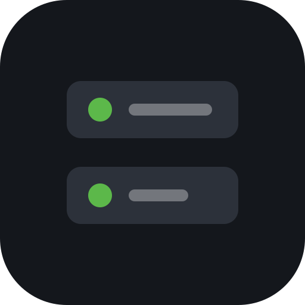
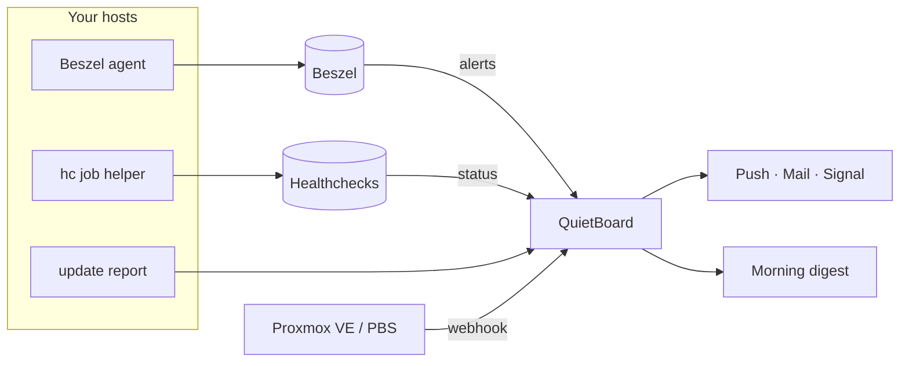

<p align="center">
  
</p>

<h1 align="center">QuietBoard</h1>

<p align="center">
  <strong>Your homelab at a glance – silent when everything is fine.</strong><br>
  Hosts, backups and updates in one calm view. One morning digest instead of a hundred alerts. Sets itself up.
</p>

<p align="center">
  <a href="https://github.com/A13nka/quietboard/actions/workflows/ci.yml"></a>
  <a href="https://github.com/A13nka/quietboard/releases/latest"></a>
  <a href="LICENSE"></a>
  
  
</p>

<p align="center">
  <a href="#quick-start">Quick start</a> ·
  <a href="https://a13nka.github.io/quietboard/">Documentation</a> ·
  <a href="https://github.com/A13nka/quietboard/releases">Releases</a> ·
  <a href="README.de.md">Deutsch</a>
</p>

<p align="center">
  
  
  &nbsp;
  
  
  &nbsp;
  
  
</p>

---

## Why QuietBoard?

[Beszel](https://github.com/henrygd/beszel) watches your machines, [Healthchecks](https://github.com/healthchecks/healthchecks) watches your cron jobs and backups. Both are excellent – but setting them up, wiring the alerts and checking two dashboards is work. And most of the time you only want to know one thing: **is everything fine?**

QuietBoard installs both, configures them for you and puts one calm view on top – in the browser and as an app on your phone. If everything is green, it stays quiet. If something breaks, you hear about it right away. Every morning you get one short summary.

## Features

- **One overview** – hosts (CPU, RAM, disk), jobs (backups, scripts, Proxmox tasks) and pending updates, sorted by what needs your attention.
- **Quiet when fine, loud when not** – push, mail or Signal when a host goes down, a backup is missing or security updates pile up. Otherwise one **morning digest**.
- **Sets itself up** – one command installs the stack; Healthchecks and Beszel are provisioned automatically, alerts included.
- **One command per host** – Beszel agent (Docker or binary), job helper `hc`, update report and automatic security updates. Debian, Ubuntu, Proxmox and Synology.
- **No cloud required** – runs entirely in your LAN or VPN. Cloudflare, Tailscale and friends are optional.
- **Accounts and roles** – admins and read-only users, API tokens for your own scripts, login throttling, optional Cloudflare Access.
- **Jobs in a few clicks** – templates for backup scripts, cron jobs, certificates, Proxmox VE/PBS and tools with a ping URL; QuietBoard shows exactly what to put where. Prefer files? `checks.yaml` works too.
- **Scriptable** – every action is also available via the API.

## Quick start

**1. Install the server** (Debian/Ubuntu with Docker):

```bash
curl -fsSL https://github.com/A13nka/quietboard/releases/latest/download/install.sh | ADMIN_EMAIL=you@example.org bash
```

**2. Open the printed address**, enter the setup code and create your admin account.

**3. Add your hosts:** *System → Add host* shows one command – run it on every machine you want to watch:

```bash
curl -fsSL -H "Authorization: Bearer <token>" http://<server>:8088/api/install/host.sh | bash
```

Hosts appear within a minute. Report jobs with `hc run <check> -- <command>`.

Prefer not to pipe into bash? Download the release bundle, verify `SHA256SUMS` and run `./install.sh` – see the [installation guide](https://a13nka.github.io/quietboard/install/).

## How it works



Beszel and Healthchecks stay the engines: they keep measuring and alerting even if QuietBoard itself is down.

## Requirements

| | |
| --- | --- |
| Server | Linux with Docker and Compose – a small VPS, VM, mini PC or Raspberry Pi (amd64 or arm64) |
| Memory | about 350 MB RAM for the whole stack; 1 GB is plenty, 2 GB with Signal |
| Hosts | Debian/Ubuntu (incl. Proxmox), Synology DSM 7; any Docker host via the agent container |
| Network | port 8088 for the app; 8000 and 8090 only for your own hosts – LAN or VPN, nothing has to be public |

## Documentation

The [documentation](https://a13nka.github.io/quietboard/) covers installation and network variants (LAN, VPN, Tailscale/NetBird, reverse proxy, Cloudflare Tunnel), adding hosts, jobs, notifications, accounts, updates and backups. It is German for now; English follows together with the English UI.

## Roadmap

- English UI and docs
- Update reports for more NAS systems (UGREEN, QNAP, TrueNAS, Unraid)
- More job templates (restic/borg wrappers, Home Assistant, databases)

## Contributing

Bug reports, host recipes and translations are welcome – see [CONTRIBUTING.md](CONTRIBUTING.md). Development in short:

```bash
make setup && make dev   # http://localhost:8088 with sample data
```

Security issues: please report privately, see [SECURITY.md](SECURITY.md).

## License

[MIT](LICENSE). QuietBoard builds on [Beszel](https://github.com/henrygd/beszel) (MIT), [Healthchecks](https://github.com/healthchecks/healthchecks) (BSD-3-Clause) and, optionally, [signal-cli-rest-api](https://github.com/bbernhard/signal-cli-rest-api) – all run as unmodified upstream images. Third-party licenses of the QuietBoard image: [THIRD_PARTY_NOTICES.md](THIRD_PARTY_NOTICES.md).
